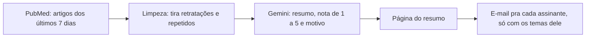

# Radar de artigos

Toda segunda de manhã, o radar busca no PubMed os artigos novos dos temas escolhidos, usa IA (Gemini) pra resumir cada um em português e dar uma nota de relevância, e manda o resumo por e-mail. Cada pessoa recebe só os temas que pediu.

Foi feito pro Núcleo de Pesquisas em Oncologia da UFPA, que acompanha a literatura sobre câncer gástrico, mas funciona com qualquer tema do PubMed.

## Como funciona



1. **Busca:** o R consulta o PubMed pela API oficial (E-utilities) e baixa título, revista e abstract dos artigos que entraram na última semana.
2. **Limpeza:** tira avisos de retratação e errata, e artigos repetidos entre temas.
3. **IA:** manda os abstracts de cada tema numa única chamada pro Gemini, que devolve uma tabela com resumo, nota e motivo de cada artigo.
4. **Envio:** monta o resumo, destaca os artigos com nota 4 ou 5 e manda um e-mail pra cada assinante.

O GitHub Actions roda tudo sozinho toda segunda às 8h, horário de Belém.

## Decisões de projeto

- **A IA só lê e julga; quem busca é o PubMed.** Os artigos e os links vêm direto da base, e a IA só pode usar o título e o abstract que recebeu.
- **Resposta em formato fixo.** O Gemini devolve uma tabela (PMID, resumo, nota, motivo) em vez de texto livre, então o código consegue ordenar e filtrar.
- **Uma chamada por tema, e não por artigo**, pra caber no limite do plano gratuito.
- **Se um modelo cair, passa pro próximo.** Há uma lista de modelos em ordem de preferência, e quem falha é pulado no resto da execução.
- **Destaque só pro que importa.** Artigos com nota 4 ou 5 aparecem com resumo; o resto vira uma lista de títulos.
- **Privacidade.** Chave, senha e lista de e-mails ficam nos secrets do GitHub, e o log mostra só quantos e-mails foram enviados, nunca os endereços.

## Quero receber o resumo

Se você é do NPO/UFPA, manda pro Kauê o seu e-mail e os temas que te interessam.

## Quero ter o meu próprio radar

1. No topo desta página, clique em **Use this template → Create a new repository**.
2. No seu repositório novo, abra o `temas.R`, clique no lápis e troque os temas e o perfil do grupo (veja abaixo como).
3. Crie uma chave da API do Gemini no [Google AI Studio](https://aistudio.google.com) e uma [senha de app](https://myaccount.google.com/apppasswords) no Gmail, que precisa da verificação em duas etapas ligada.
4. Em **Settings → Secrets and variables → Actions**, crie quatro secrets:

   | Secret | O que colocar |
   | --- | --- |
   | `GEMINI_API_KEY` | sua chave do Gemini |
   | `GMAIL_USUARIO` | o Gmail que vai enviar os resumos |
   | `GMAIL_SENHA_APP` | a senha de app, sem espaços |
   | `ASSINANTES` | quem recebe e quais temas (formato abaixo) |

5. Em **Actions → Radar de artigos → Run workflow**, rode uma vez pra testar. Depois ele roda sozinho toda segunda.

## Como personalizar

**Temas** (`temas.R`): cada tema é um nome e uma busca do PubMed. Pra criar um, acrescente um item na lista `temas`. O primeiro exemplo usa o bloco `cancer_gastrico`, que já está pronto no arquivo; o segundo é uma busca sobre outro assunto qualquer:

```r
"Microbiota" = paste(cancer_gastrico,
  'AND (microbiota[Title/Abstract] OR microbiome[Title/Abstract])'),
"Imunoterapia em melanoma" =
  'melanoma[Title/Abstract] AND immunotherapy[Title/Abstract]'
```

Teste a busca antes em [pubmed.ncbi.nlm.nih.gov](https://pubmed.ncbi.nlm.nih.gov): se ela trouxer os artigos certos lá, vai trazer aqui.

**Perfil do grupo** (`interesses_do_grupo`, no fim do `temas.R`): uma frase sobre o que o grupo estuda. A IA usa essa frase pra dar a nota de relevância.

**Perfil por tema** (`interesses_por_tema`, opcional): pra um tema que foge do perfil do grupo, escreva uma frase só dele. Sem isso, um tema sobre pulmão, por exemplo, seria avaliado com o olhar de quem estuda estômago e quase tudo ganharia nota baixa.

**Assinantes** (secret `ASSINANTES`): separe as pessoas com ponto e vírgula e use os nomes dos temas como estão no `temas.R`. Quem não escolher tema, ou escrever `todos`, recebe todos.

```
ana@gmail.com: lncRNA, Microambiente imune; joao@gmail.com: todos
```

**Ajustes finos:** no começo do `radar.R` ficam `dias` (janela de busca), `max_por_tema`, `nota_destaque` e a lista de `modelos`. O dia e a hora do envio ficam na linha do `cron`, em `.github/workflows/radar.yml` (em UTC).

## Rodar no seu computador

Precisa do R 4.1 ou mais novo. Crie na pasta um arquivo `chave_api.txt` com:

```
GEMINI_API_KEY=sua_chave
GMAIL_USUARIO=seuemail@gmail.com
GMAIL_SENHA_APP=suasenhadeapp
ASSINANTES=seuemail@gmail.com: todos
```

E rode no console do R:

```r
setwd("caminho/da/pasta/radar-de-artigos")
source("radar.R")
```

O resumo é salvo em `saidas/` e abre no navegador. Sem as linhas do Gmail, ele só gera a página e não manda e-mail. O `chave_api.txt` está no `.gitignore` e nunca vai pro GitHub.

## Limitações

- Os resumos são feitos por IA a partir do abstract e podem ter erros: confira sempre o artigo original.
- A nota de relevância segue o perfil do tema (ou do grupo, quando o tema não tem perfil próprio), e não o de cada pessoa.
- No plano gratuito, os modelos do Gemini às vezes ficam sobrecarregados; por isso existe a lista de modelos reserva.
- O GitHub pausa as execuções agendadas de repositórios públicos depois de 60 dias sem nenhuma alteração. Se isso acontecer, é só reativar na aba Actions.

## Como foi construído

Em R (rentrez, xml2, ellmer e commonmark), com GitHub Actions pra agendar a execução. Desenvolvido com ajuda do Claude como copiloto de código.

Kauê Sant'Ana · Biotecnologia, UFPA
